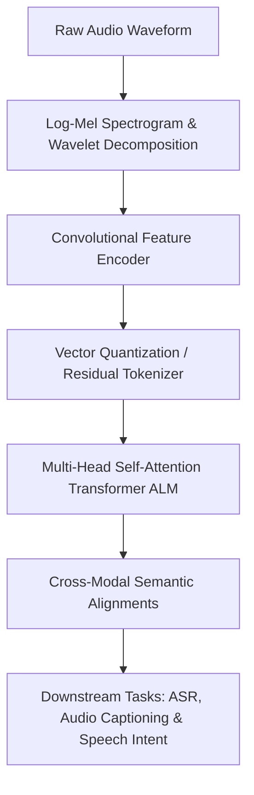

<div align="center">

  <!-- NATIVE ANIMATED CYBER BANNER -->
  

  <br/>

  <!-- ANIMATED TYPING SVG -->
  

  <br/>

  <!-- TECH BADGES -->
  <p align="center">
    
    
    
    
    
  </p>

</div>

---

### 🌟 System Overview

**Deep Learning based Audio Language Model (ALM)** implements cutting-edge neural architectures for joint speech-text representation learning. It processes raw acoustic waveforms into discrete latent tokens, enabling cross-modal semantic understanding, speech synthesis, and acoustic feature classification.

---

### 🔬 Operational Architecture & Data Pipeline Flow



---

### 🚀 Key Capabilities & Features

- **🌊 Raw Waveform Tokenization:** Converts continuous acoustic signals into discrete tokens via neural residual vector quantization.
- **🧠 Attention-Based Semantic Extraction:** Deep Transformer layers capturing both phonemic nuances and global contextual intent.
- **⚡ High-Efficiency Inferencing:** Optimized inference pipelines with support for GPU-accelerated batch evaluation.
- **📊 Audio Augmentation Suite:** SpecAugment, time-stretching, and background noise injection for robust generalizability.

---

### ⚡ Quickstart & Execution

```bash
# 1. Clone & enter
git clone https://github.com/Akshay-Notfound/Deep-Learning-based-ALM.git
cd Deep-Learning-based-ALM

# 2. Setup environment
pip install -r requirements.txt

# 3. Train or run audio inference
python train.py
python inference.py --audio sample.wav
```

---

### 👤 Author & Architecture

**Akshay Shivaji Rathod**  
*Data & AI Engineer*  
* 🌐 **Portfolio:** [akshay-notfound.vercel.app](https://akshay-notfound.vercel.app)  
* 💼 **LinkedIn:** [linkedin.com/in/akshay-rathod-aaab52206](https://www.linkedin.com/in/akshay-rathod-aaab52206/)  
* 🐙 **GitHub:** [@Akshay-Notfound](https://github.com/Akshay-Notfound)  

---

<div align="center">
  <sub>Licensed under the MIT License. Designed for scalability, intelligence, and performance.</sub>
</div>
